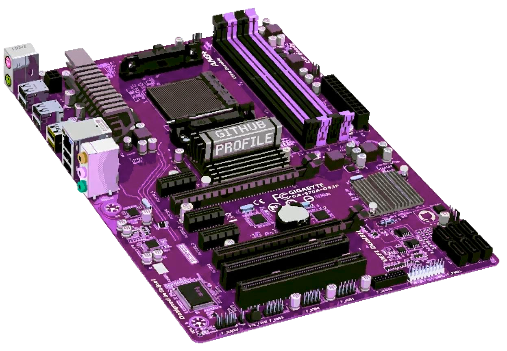

  <!-- تصویر مادربرد شما از مخزن گیت‌هاب -->
  
  
    
  
  <h2 style="color: #A855F7; margin-bottom: 5px;">Hello there! I'm <b>Hossein Salmani</b></h2>
  
  

 

  Focused on client-side troubleshooting and IT infrastructure. I provide comprehensive hardware, software, and passive network support, backed by specialized training and professional work experience.

 

### **⚡ Core Skills**

   &nbsp;
   &nbsp;
  

*   **Hardware:** PC Assembly, Component Testing, Upgrades & Maintenance.
*   **Software:** OS Installation, Configuration, and User-End Troubleshooting.
*   **Passive Network:** Managing physical layer tasks and passive network maintenance.

 

---

  

